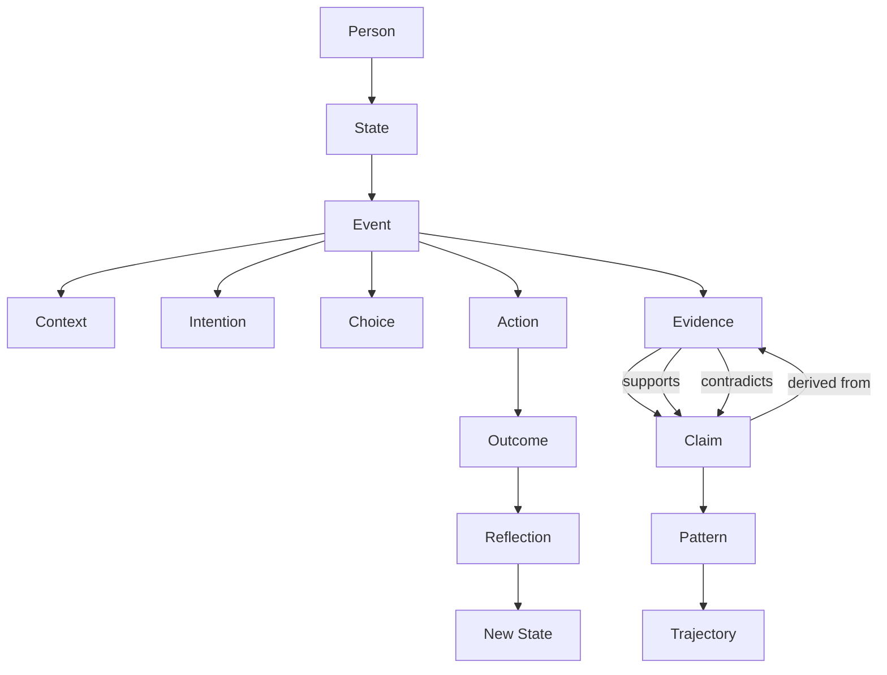
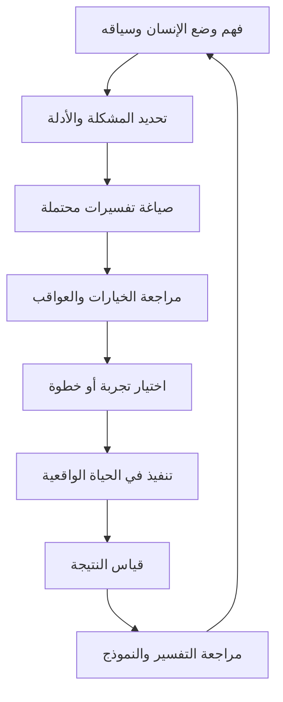

# TEC Life — Human Development reports (owner, 2026-10-17)

> Truth State: **[Future Vision]** · Governance State: **[Draft]** · Verification: **[Assumed]**
> — none of this is code. A **record**: the owner's design reports on Life, kept as the owner
> sent them, so later sessions can return to them. The reading of them against what Life already
> is, and Life's goals as an independent app, are in
> `audits/LIFE_VISION_HUMAN_DEVELOPMENT_2026-10-17.md`.
>
> A faithful record, in the owner's words and Arabic: Report 1 nearly verbatim; the others condensed
> point by point — every decision, rule, list and example kept, nothing added or reinterpreted.
> Diagrams were flattened to text where they were drawn with box characters. The embedded image
> links were removed (third-party pictures). Section numbers (161 → 187) are the owner's own
> numbering in a longer series, not KB numbers.

---

## Report 1 — Human DNA Graph v0.1

نكمل. الآن نصل إلى Human DNA Graph v0.1؛ وهنا سنحوّل الـDNA من طبقات نظرية إلى Graph له Nodes وRelationships محددة.

### 161. القاعدة الأساسية

لا نريد Graph بهذا الشكل:

```
User
├── Name
├── Age
├── Interests
└── Goals
```

هذا User Profile.

نريد:

```
PERSON
↓
STATE
↓
EVENT
↓
EVIDENCE
↓
PATTERN
↓
TRAJECTORY
```

والعلاقات هي التي تعطي البيانات معناها.

### 162. Human DNA Graph

النواة:

```
PERSON
  ↓
STATE
  │ contains
  ↓
EVENT
  ├── INTENTION
  ├── CHOICE
  └── ACTION
        ↓
     OUTCOME
        ↓
    REFLECTION
        ↓
      CHANGE
        ↓
    NEW STATE
```

ثم:

```
EVENTS → EVIDENCE → PATTERNS → TRAJECTORY
```

### 163. Nodes

أريد أن نبدأ بـ12 Node فقط.

Core Nodes:

1. Person
2. State
3. Event
4. Context
5. Intention
6. Goal
7. Choice
8. Action
9. Outcome
10. Reflection
11. Pattern
12. Trajectory

ثم Node خاص: **Evidence** — وأخيرًا: **Claim**.

إذن فعليًا لدينا: 14 core computational nodes.

### 164. لماذا Claim؟

لأن النظام لا يخزن فقط: Data. بل يخزن: Claims about the person.

مثلاً:

```
Claim: "User tends to postpone ambiguous decisions."
Claim ↓ supported_by → Evidence
```

وبذلك لا تصبح الـPattern حقيقة سحرية.

### 165. Relationship Types

أقترح مجموعة محدودة:

```
HAS_STATE · OCCURRED_IN · CONTAINS · INTENDS · PURSUED_FOR · CHOSE · EXECUTED · RESULTED_IN
REFLECTED_ON · CHANGED · SUPPORTS · CONTRADICTS · EXHIBITS · PART_OF · PRECEDES · FOLLOWS
DERIVED_FROM
```

هذه العلاقات تكفي لبناء أول Graph قوي.

### 166. مثال كامل

```
Person
└── HAS_STATE → State_17
    └── CONTAINS → Event_81
        ├── Intention_12
        ├── Choice_44
        └── Action_73
              ↓
           Outcome_91
              ↓
          Reflection_20
              ↓
            State_18
```

ثم: `Event_81 → Evidence_301 → supports → Pattern_07`

### 167. Pattern Graph

Pattern لا يعيش وحده.

```
Pattern_07
├── SUPPORTED_BY: Event_11, Event_22, Event_41, Event_81
├── CONTRADICTED_BY: Event_64
└── OCCURS_IN: Context_A, Context_B
```

وهذا يعطي النظام قدرة على قول: النمط موجود، لكن توجد أيضًا أدلة مخالفة.

### 168. Pattern ليس Label

لا: `Pattern = "Indecisive Person"`

بل:

```
Pattern: Decision postponement
Context: High ambiguity
Evidence: 8 events
Status: Active
```

أي أن الـPattern سلوكي وسياقي وقابل للتغير.

### 169. Goal Graph

Goal له علاقة بالنية: `Intention └── PURSUED_FOR → Goal`

مثلاً: Intention: "I want to build a company." — Goal: "Launch MVP."

لكن يمكن أن تكون: one Intention → multiple Goals، و one Goal → multiple Actions.

### 170. Decision Graph

Decision لا نحتاجه كـPrimitive في الـOntology، لكنه مهم في الـComputational Model.

```
Decision
├── FOR → Goal
├── BASED_ON → Evidence
├── CONSTRAINED_BY → Context
├── SELECTED → Choice
└── RESULTED_IN → Outcome
```

وهذا يسمح بإعادة استخدام Decision Core القديم بشكل نظيف.

### 171. Context Graph

Context أيضًا Graph:

```
Event └── OCCURRED_IN └── Context
    ├── Time
    ├── Environment
    ├── Resources
    ├── Relationships
    └── Constraints
```

لكن لا نخزن كل السياق في كل Event. نستخدم: relevance — بحيث يكون السياق المرتبط بالحدث فقط.

### 172. State Graph

الـState ليس Node منعزلًا.

```
State_01 ── precedes → State_02 ── changed_by → Event_17
```

والـTrajectory تصبح: `Trajectory ├── State_01 … State_05`

### 173. Turning Point

يمكن تمثيله كـEvent له أثر كبير على State.

```
Event ↓ significant_change ↓ State Transition
Trajectory └── TURNING_POINT → Event
```

لكن "significant" يجب أن يكون معرفًا تقنيًا، وليس حكمًا شخصيًا.

### 174. Human DNA Graph لا يجب أن يكون كله Mutable

نحتاج فصلًا بين:

- Immutable history: Event · Evidence · Timestamp · Source
- Mutable interpretation: Pattern · Confidence · Inference · Current State

لأن الحدث التاريخي لا ينبغي أن يتغير لمجرد أن تفسيرنا له تغير.

### 175. مثال مهم

حدث: 2026-09-01 — User postponed a decision.

بعد شهر: New interpretation: The postponement was caused by missing information.

بعد شهر آخر: Pattern: not general indecision; specific response to insufficient information.

إذن: EVENT stays stable. INTERPRETATION evolves. هذه خاصية أساسية.

### 176. وهذا يفرق بين Data وKnowledge

```
DATA → EVENT
KNOWLEDGE → PATTERN / RELATION
INTERPRETATION → CLAIM
MODEL → HUMAN DNA
```

وبذلك نستطيع دائمًا الرجوع إلى المصدر.

### 177. Human DNA Graph + Epistemic Graph

أريد طبقة ثانية موازية:

```
CLAIM
├── SUPPORTED → EVIDENCE
└── CONTRADICTED → EVIDENCE

Claim ├── status ├── confidence ├── provenance └── model_version
```

إذن لدينا: Human Graph + Epistemic Graph — وهذا أقوى من Graph واحد بسيط.

### 178. أين Qur'an + Sunnah داخل Graph؟

ليس كالتالي: `Person ↓ Quran verse` — لأن هذا يحول المصدر إلى Feature.

الأصح:

```
FOUNDATIONAL KNOWLEDGE GRAPH → HUMAN ONTOLOGY → HUMAN COMPUTATIONAL MODEL → PERSON
```

أي أن المصدر يؤسس الـModel. لكن يمكن الاحتفاظ بـ:

```
OntologyConcept └── grounded_in ├── Qur'an source └── Sunnah source
```

مع تفسير العلماء/المراجعة العلمية.

### 179. Source Provenance Graph

```
SOURCE → INTERPRETATION → ONTOLOGY CONCEPT → COMPUTATIONAL ABSTRACTION
```

مثلاً: Qur'anic source → Scholarly interpretation → Concept: Intention → Model entity: Intention.
وهذه السلسلة يجب ألا تُكسر.

### 180. هذه النقطة تحمي المشروع من مشكلة كبيرة

إذا جاء شخص وقال: "لماذا النظام يعرف هذا عن الإنسان؟" — نستطيع التمييز:

1. Source-derived?
2. User-declared?
3. Observed?
4. Inferred?
5. Unknown?

بدل أن يكون كل شيء مخلوطًا داخل AI memory.

### 181. Core Graph

```
PERSON └── HAS_STATE → STATE └── CONTAINS → EVENT
    ├── INTENTION ├── CHOICE └── ACTION
        → OUTCOME → REFLECTION → CHANGE → STATE

وبالتوازي: EVENT → EVIDENCE → CLAIM → PATTERN → TRAJECTORY
```

هذه هي DNA Graph Core v0.1.

### 182. Queryable Human Model

بعد بناء Graph بهذا الشكل، يمكن للنظام الإجابة عن أسئلة لا يستطيع Profile عادي الإجابة عنها:

- ما القرارات التي اتخذتها تحت ضغط الوقت؟ — `Decision → occurred_in → Context(time_pressure)`
- ما الأنماط التي ظهرت ثم اختفت؟ — `Pattern → ACTIVE → WEAKENED → RETIRED`
- ما الأحداث التي ساهمت في التغيير الحالي؟ — `Current State ← Transition ← Event ← Evidence`

وهنا يبدأ النظام يصبح Human Intelligence Infrastructure وليس مجرد تطبيق.

### 183. Graph Rules

```
RULE: A Pattern cannot exist without supporting Evidence.
RULE: An inferred Intention cannot be treated as a declared Intention.
RULE: A single Event cannot create a persistent Pattern.
RULE: A Pattern may be weakened by contradictory Evidence.
RULE: Historical Events are immutable; interpretations are revisable.
RULE: Unknown must remain Unknown unless new Evidence appears.
```

### 184. بداية الـInference Engine

بدل: LLM decides — يصبح:

```
LLM → candidate claim → Rule Engine → Evidence validation → Graph update
```

أي: **LLM proposes; the system validates.** وهذه جملة معمارية أعتبرها أساسية.

### 185. الـAI Agent

```
AI AGENT: Understand · Retrieve Human DNA · Retrieve Evidence · Reason · Propose · Validate · Explain · Update
```

وليس: ChatGPT + huge prompt.

### 186. الصورة النهائية حتى هذه اللحظة

```
QUR'AN + SUNNAH → FOUNDATIONAL MODEL → HUMAN ONTOLOGY → HUMAN MODEL → PERSON MODEL
  → HUMAN DNA GRAPH (EVENT GRAPH + EPISTEMIC GRAPH) → TRAJECTORY → DECISION INTELLIGENCE
  → ACTION → OUTCOME → DNA UPDATE
```

### 187. عتبة مهمة

بعد كل هذا، لا أنصح بإضافة طبقات فلسفية جديدة الآن. أصبح لدينا: Human Ontology · Human Model ·
Human Event · Human DNA · Human DNA Graph · Evidence Model · Epistemic Model · Trajectory ·
Decision Intelligence · Human Mirror.

والخطوة التالية هي تحويل كل هذا إلى Formal Specification: HumanModel v0.1 · HumanEvent v0.1 ·
HumanDNA v0.1 · Evidence v0.1 · Pattern v0.1 · Trajectory v0.1 · Decision v0.1 — ثم JSON Schema +
Graph Relations + Update Rules.

نقطة التثبيت الحالية:

```
Qur'an + Sunnah → Model of Humanity → Human Ontology Core v1.0 → Human Model v0.1 → Human Event v0.1
→ Evidence + Epistemic Layer → Human DNA v0.1 → Human DNA Graph → Trajectory Engine → Human Mirror
→ Decision Intelligence → Action → Outcome → Update
```

المواصفات المطلوبة: human-model.schema.json · human-event.schema.json · human-dna.schema.json ·
evidence.schema.json · pattern.schema.json · trajectory.schema.json · Graph relationships · DNA
update rules · Epistemic rules · Decision Engine interface.

والقاعدة الأساسية: **النظام ينمذج الإنسان، لكنه لا يخترع الإنسان.** ولن نخلط بين ما حدث، وما
قاله المستخدم، وما استنتجه النظام.

---

## Report 2 — Architecture Review v2

بعد مقارنة المعمارية التي كنا قد بنيناها مع التصور الذي وصلنا إليه الآن، التغيير ليس مجرد تعديل
Features؛ بل إعادة تعريف للـCore Architecture. ولا نرمي المعمارية السابقة.

**1. الخلاصة التنفيذية.** المعمارية السابقة: المستخدم لديه هدف/مشكلة → نفهمها → نحللها → نوجهه →
نقيس النتيجة. كانت قوية في Intent · Goal · Evidence · Behavior · Decision · Outcome · Feedback ·
Personal Model · Micro-frictions · Decision/Outcome Graph · Human API. التصور الجديد: الإنسان لا يأتي
فقط لحل مشكلة؛ هو يعيش حياة كاملة ويتخذ آلاف القرارات، والنظام يجب أن يساعده على بناء طريقة أفضل
للعيش واتخاذ القرار من البداية.

```
HUMAN → LIFE CONTEXT → (Goals · Decisions · Behavior) → HUMAN MODEL → (Patterns · Risks · Gaps)
→ DECISION ENGINE (Behavioral Science + Islamic Reference: Qur'an + Sunnah) → ACTION DESIGN
→ REAL LIFE → EVIDENCE → OUTCOME / CHANGE → MODEL UPDATE → loop
```

**2. ما كانت المعمارية السابقة.** A — Decision → Outcome Graph (Decision → Action → Outcome →
Evidence) يبقى أساسيًا. B — Micro-Frictions (Micro-friction → Repeated behavior → Pattern → Problem)
يبقى، وأصبح أهم. C — Human API (Behavioral Patterns → Personal Behavior Model → Reusable
Intelligence) لا نحذفه، لكن من Behavior Model إلى Human Model — لأن الإنسان أكبر من سلوكه.

**3. أين كانت المشكلة؟** ليست تقنية؛ كانت Product Ontology. كنا نسأل: ما هدف المستخدم؟ ثم كيف
نساعده يصل إليه؟ لكن الإنسان قد يكون لديه هدف خاطئ أصلًا. مثال: "عايز أكسب مليون جنيه." النظام
الجديد يسأل داخليًا: هل الهدف واضح؟ كيف سيصل إليه؟ ما المخاطر؟ من سيتأثر؟ ما الوعود التي سيقدمها؟
هل طريقة الوصول نفسها سليمة؟ — Goal ليس الـNorth Star. الـNorth Star أصبح: **Human Development**.

**4. من Goal-centric إلى Life-centric.** القديمة: User → Intent → Goal → Plan → Action → Outcome.
الجديدة: User → Life Context → Human Model → Intent / Goal / Decision → Context + Consequences →
Action → Evidence → Outcome → Model Update. Goal أصبح كيانًا داخل النظام، وليس النظام كله.

**5. الـCore Primitive الجديد — Development Loop:** Intent · Context · Decision · Action · Evidence ·
Outcome · Reflection · Model Update. لا يجب أن يبدأ كل شيء بـIntent؛ أحيانًا النظام يكتشف شيئًا من
الـEvidence: Evidence → Pattern → Potential Gap → User Confirmation → Development Loop.

**6. Human Model — Human Development Model** بطبقات: Context (Work · Family · Business · Money ·
Relationships · Learning · Health-related lifestyle · Time · Projects · Decisions) · Intent · Behavior ·
Patterns · Decision tendencies · Strengths · Frictions · Risks · Development trajectory
(Human Model(t0) → Experience → Human Model(t1) → …) — الـLongitudinal Model الذي كان ناقصًا.

**7. المرجعية الإسلامية — التغيير الأكبر.** لا نريد: User → Question → Quran Search → Verse، ولا
"هذا حرام"، ولا Islamic advice chatbot.

**8. Islamic Reference Architecture:** PRIMARY SOURCES (Qur'an · Sunnah) → AUTHENTICATED KNOWLEDGE →
PRINCIPLES → HUMAN QUALITIES → DECISION PATTERNS → LIFE SCENARIOS → DEVELOPMENT RULES. لا نريد
تحويل الدين إلى IF X THEN HARAM؛ النظام يفهم النص، السياق، المقصد، السلوك، النتيجة، اختلاف
الحالات، حدود الاستنتاج. والأحكام الدينية الصريحة، خصوصًا المسائل الفقهية، لا يخترعها AI.

**9. Source vs Inference:** Level A — Source (النص الموثق) · Level B — Scholarly Interpretation ·
Level C — Product Application. ولا نخلط الثلاثة.

**10. الـAI Architecture:** AI ORCHESTRATOR → Context Engine · Human Model · Decision Engine →
Behavioral Layer + Islamic Reference Layer → Intervention Engine → Outcome Engine. الـLLM هنا
reasoning/interface component — ليس مصدر الحقيقة.

**11. Decision Engine:** Goal Fit + Evidence + Consequences + Risk + Consistency + Human Development +
Value Alignment + Uncertainty.

**12. لا "Moral Score".** لا "أخلاقك = 72%". بدلًا: Behavior → Evidence → Observed consequence →
Pattern → Development opportunity. النظام يصف السلوك والتطور، ولا يصدر حكمًا على قيمة الإنسان.

**13. ليس Habit Tracker.** Life ├── Decisions · Behaviors · Goals · Projects · Relationships · Habits
· Problems · Opportunities · Development.

**14. مثال الشركة:** Idea → Problem → Customer → Promise → Business Model → Operational Decisions →
Risk → Customer Impact → Execution → Evidence → Outcome — ويبحث مبكرًا عن: ادعاء غير قابل للإثبات ·
وعد غير قابل للتنفيذ · تضارب مصالح · استغلال · إخفاء معلومات مهمة · سوء إدارة أموال · قرار اندفاعي
· تجاهل حقوق الآخرين · مخاطرة غير محسوبة.

**15. Micro-Error Detection:** Small Decision → Repeated → Pattern → Potential Harm. مثال: تأخير
بسيط في الوفاء بالوعود — لو أصبح pattern: Overpromise → Delay → Excuse → Customer distrust.

**16. Evidence Engine:** Claim: "I became more disciplined." → What changed? When? In what context?
How often? What evidence? What outcome? — Self Report + Observed Data + Behavioral Evidence +
Outcome → Confidence، وليس حكمًا قطعيًا.

**17. Human Development Graph:** Person ├── Context · Intent · Decision · Behavior · Pattern ·
Intervention · Outcome · Development State — والزمن جزء أساسي: Person(t0), Person(t1), …

**18. ما نحتفظ به:** Intent ✓ · Goal (ككيان فرعي) · Evidence (Core) · Normalization ✓ · Decision
Engine (Core + توسعة) · Outcome (Core) · Decision/Outcome Graph (توسيع) · Micro-Frictions ✓ ·
Personal Behavior Model → Human Model · Human API (مستقبلية) · Adaptive Coaching (capability داخلية)
· AI Chat (Interface فقط) · Habit Tracking (Feature) · Goals Dashboard (Feature) · Islamic Content →
Reference Layer.

**19. ما نحذفه من القلب:** Islamic AI Chatbot · Habit-first · Goal-first · Religious content feed ·
Streak economy · Moral scoring · "AI gives advice".

**20. ما نضيفه:** Human Model · Islamic Reference Engine · Development Engine · Life Decision Engine.

**21. المعمارية V2:** USER → EXPERIENCE LAYER → CONTEXT ENGINE → HUMAN MODEL (Longitudinal State) →
Decision Engine · Behavior Engine · Development Engine → REFERENCE LAYER (Qur'an · Authentic Sunnah ·
Scholarly Knowledge · Behavioral Science) → INTERVENTION ENGINE → REAL WORLD ACTION → EVIDENCE ENGINE
→ OUTCOME ENGINE → MODEL UPDATE → LOOP.

**22. Reference Layer ليست User Layer:** المرجعية authoritative داخل النظام، وليست conversational
content افتراضيًا. الـAI لا يجيب "الإسلام يقول…" إلا عندما يُطلب.

**23. المستخدم غير المسلم:** المعمارية لا تتغير: User → Human Problem → Human Model → Development.
لكن الـnormative foundation معلن في Terms / About / Methodology.

**24. أكبر خطر:** الـAI يختلق مرجعية دينية. LLM ≠ Islamic Authority. يجب: Retrieval · Verification
· Attribution · Confidence · Escalation. والـAI ممنوع من تحويل التخمين إلى "حكم شرعي".

**25. أكبر فرصة:** فئة مختلفة: Human Development Infrastructure — يبدأ بمنتج واحد، ثم يصبح الـHuman
Model وDevelopment Engine طبقة لمنتجات أخرى (Human API).

**26. الـMVP:** حلقة واحدة: User Problem → Context → Human Model → Decision → Intervention →
Evidence → Outcome → Model Update. بدون Habit marketplace، Social، Gamification، مكتبة دينية في
الواجهة.

**27. التقييم:** السابقة — Foundation قوية؛ Product Ontology ضيقة. الجديدة تضيف Human → Life →
Development → Decision → Evidence → Change.

**28. 5 Core Engines:** HUMAN DEVELOPMENT OS → Human Model · Decision Engine · Development Engine →
Evidence / Outcome → Model Update — underneath: ISLAMIC REFERENCE FOUNDATION (Qur'an + Authentic
Sunnah). الـAI طبقة intelligence فوق المحركات، ليس Engine في القمة.

**29. الخلاصة:** إعادة توجيه المعمارية من Decision/Goal System إلى Human Development System:
Human → Life Context → Human Model → Intent / Goal / Decision → Evidence + Reference → Development
Decision → Action → Outcome → Human Model Update → Longitudinal Development. الخطوة التالية: تثبيت
Human Development Core Model v1.0.

---

## Report 3 — Formal Specification order

نبدأ بـ Human Development Core Model v1.0 — Draft 0.1. لازم نفصل بين نموذج الإنسان، وسجل الأحداث،
والأدلة، والتفسيرات، ومحرك اتخاذ القرار.



القرارات المعتمدة: التاريخ ثابت والتفسير قابل للمراجعة · Unknown لا تعني False · لا نمط مستمر من
حدث منفرد · النية المستنتجة ليست نية معلنة · LLM proposes; system validates · المرجعية الإسلامية
تؤسس النموذج (المصدر، والتفسير العلمي، والتجريد الحاسوبي مستويات منفصلة).

الترتيب: 01 Human Model v0.1 · 02 Human Event v0.1 · 03 Evidence & Claim · 04 Human DNA Graph ·
05 Trajectory & Decision Interface (لمحرك TECO Decision Core). الـ14 Node ليست بالضرورة 14 جدولًا.

---

## Report 4 — Life: what makes it strong, and its risks

Life — بناء الإنسان وإرشاده — قوته ليست في إعطاء النصائح؛ قوته في فهم الإنسان ومتابعة تطوره
ومساعدته على اتخاذ قرارات أفضل بمرور الوقت. يمكن أن يكون منتجًا مستقلًا يخدم مجتمع Pi، وفي المستقبل
مستخدمين خارجه.

- **المميز:** فهم الإنسان بدل تسجيل بياناته · فهم التطور عبر الزمن · إرشاد مرتبط بالأدلة (بدل "أنت
  متردد": المواقف، الأدلة المؤيدة والمخالفة، السياق).
- **بناء الإنسان** يصف الغاية، وLife المنتج: تحسين طريقة التفكير، التعامل مع المسؤوليات، اتخاذ
  القرارات، التعلم من النتائج، تطوير السلوك. Life لا يصنع نسخة مثالية موحدة، ولا يمنح درجة أخلاقية.
- **المرجعية:** الفصل بين النصوص الموثقة · التفسير العلمي ومراجعة أهل الاختصاص · التجريد الحاسوبي ·
  الاستنتاج الخاص بالمستخدم. المرجعية تؤسس النموذج، ولا تبرر ادعاء معرفة نوايا الإنسان.
- **المخاطر:** أن يتحول إلى AI Life Coach آخر (مرتفع) · تعقيد Human DNA Graph قبل إثبات فائدته ·
  استنتاج أنماط غير صحيحة (ثقة) · صعوبة شرح القيمة (تسويق) · بناء كل جوانب التطوير من البداية (تشتت).
- **الصورة:** Understand · Recognize · Guide · Develop.
- **التوصية:** نعم أكمل، لكن اختبر القيمة قبل استكمال المحركات. اختر موقفًا إنسانيًا محددًا بدورة
  كاملة. مجتمع Pi نقطة بداية، لا حد.

---

## Report 5 — Six directions to develop Life

1. **Personal Causality Engine** — التمييز بين الاحتمالات (هدف غير واضح؟ معلومات ناقصة؟ وقت؟ تعارض
   أولويات؟) قبل اقتراح الحل. Event + Context + Evidence + Claim + Outcome.
2. **Future Consequence Simulator** — سيناريوهات محتملة قبل القرار المهم، كاحتمالات مشروطة لا تنبؤات.
3. **Personal Experiments Engine** — تجربة محدودة قابلة للقياس مقارنة بخط الأساس.
4. **Life Systems Graph** — ترابط جوانب الحياة (وقت، مال، تعلم، أسرة) والتكاليف الخفية.
5. **Personal Knowledge & Evidence Ledger** — ما كان يعتقده، ما ثبت، ما تغير، أين المعلومات ناقصة.
6. **Human Collaboration Layer** — لاحقًا داخل Pi؛ لا تُشارك بيانات Human DNA افتراضيًا.

**Human Development Loop:**



المرجعية في أربع مراحل: فهم الإنسان · تقييم الفعل والقرار (الوسائل والالتزامات والآثار على الآخرين)
· تصميم التغيير · مراجعة النتائج (دون تحويل الأخطاء إلى هوية ثابتة).

الترتيب: (1) Evidence + Personal Experiments — الأولوية · (2) Causality + Life Systems Graph · (3)
Future Consequence Simulator · (4) Community Layer.

ما يجعل Life صعب التقليد: نموذج إنسان زمني · معرفة قائمة على الأدلة · تعلم من النتائج الواقعية ·
مرجعية تأسيسية منضبطة. **Evidence-Driven Human Development.** أول حالة استخدام: مشكلة متكررة يريد
المستخدم تغييرها، لكن أسبابها ليست واضحة له.

---

## Report 6 — Human Development Core Model v1.0

**0. المبدأ الحاكم:** كل كيان يجيب على سؤال واحد: ما مصدر هذه المعلومة؟ إذا لم يستطع، لا يُنشأ.

**1. الكيانات:**

- L0 — Person (id, created_at, model_version — لا profile data) · Context (type: time | environment |
  resources | relationships | constraints · payload · relevance إلزامي) · State (snapshot_id,
  timestamp, version — Versioned Immutable · delta_summary).
- L1 — Event (Immutable · provenance: DECLARED | OBSERVED) · Intention (provenance: DECLARED |
  INFERRED — المستنتجة لا تُعامل كمعلنة، ولا تظهر إلا بصيغة "يبدو أن…") · Goal (status: ACTIVE |
  ACHIEVED | ABANDONED | INVALIDATED · status_reason إلزامي) · Choice · Action · Outcome (expected |
  unexpected | mixed) · Reflection (DECLARED فقط).
- L2 — Evidence (event_ref إلزامي · verifiability: HIGH | MEDIUM | LOW · Immutable) · Claim
  (provenance: SOURCE_DERIVED | DECLARED | OBSERVED | INFERRED | UNKNOWN · confidence 0–1 · status:
  PROPOSED | VALIDATED | CONTESTED | REFUTED | REVISED · version, supersedes) · Pattern
  (behavioral_description — ممنوع Labels · context_scope · lifecycle: HYPOTHESIZED | ACTIVE |
  WEAKENED | RETIRED · support/contradiction محسوبة) · Trajectory (state_refs[] · turning_points[] —
  Threshold معرف تقنيًا).
- L3 — Gap (لا يُعرض بصيغة اتهام؛ سؤال أو فرصة) · Intervention (design · target_gap_ref ·
  success_criteria قبل التنفيذ · status: DESIGNED | ACTIVE | COMPLETED | ABANDONED).
- L4 — Source (QURAN | SUNNAH | SCHOLARLY | BEHAVIORAL_SCIENCE · authentication_status) ·
  ScholarlyInterpretation (لا Principle بدونها) · Principle (derived_from · application_scope — لا
  IF X THEN HARAM).

**2. العلاقات (قائمة مغلقة):** HAS_STATE · CONTAINS · OCCURRED_IN · INTENDS · PURSUED_FOR · CHOSE ·
EXECUTED · RESULTED_IN · REFLECTED_ON · CHANGED · SUPPORTS · CONTRADICTS · EXHIBITS · ADDRESSES ·
EVALUATED_BY · GROUNDED_IN · DERIVED_FROM · APPLIES_IN · TURNING_POINT_IN · PRECEDES / FOLLOWS ·
PART_OF. أي علاقة خارج القائمة لا تُخزن.

**3. Evidence Model:** SELF_REPORT (LOW) · OBSERVED_BEHAVIOR (MEDIUM) · OUTCOME_DATA (HIGH) ·
EXTERNAL_RECORD (HIGH). R1 Evidence Immutable · R2 كل Claim يحتاج SUPPORTS أو يبقى UNKNOWN · R3 لا
Evidence عائم · R4 Confidence بمعادلة محددة، لا تقدير LLM.

**4. State Machines:** Pattern: HYPOTHESIZED → ACTIVE (support ≥ 3 في سياق متشابه) → WEAKENED
(contradiction ≥ 30%) → ACTIVE | RETIRED. Claim: PROPOSED → VALIDATED → CONTESTED ↔ REVISED (نسخة
جديدة) → REFUTED (يبقى مع دليل النقض). State: لا انتقال بدون حدث مرجعي؛ Delta على محاور ثابتة
(الالتزام بالقرارات، إدارة الوقت، جودة الوعود، الوضوح في الأهداف، التعامل مع الغموض).

**5. المرجعية:** الفصل الثلاثي إلزامي · لا استنتاج فقهي من LLM (Retrieve · Attribute ·
Confidence/Escalation · requires_human_scholar) · Foundation لا Feature · التصريح العلني في
Methodology دون شرط على المستخدم غير المسلم.

**6. حدود الـAI:** AR-1 مخرجات LLM تدخل PROPOSED فقط · AR-2 لا Moral Scoring · AR-3 UNKNOWN حق
مشروع · AR-4 كل Claim معروض قابل للتتبع · AR-5 لا Habit/Goal كـCore.

**7. Update Rules:** Event Ingested → Evidence Extraction → Candidate Claims (LLM) → Rule Engine →
Pattern Update → Gap Detection → Intervention Design → Outcome → Evidence جديد → State Transition →
Trajectory Update. confidence = f(support_count, avg(verifiability), recency_decay,
contradiction_penalty) — تُعرض Low / Medium / High فقط.

**8. خارج v1.0:** Human API · Social / Gamification / Streaks · واجهة دينية كمحتوى · محاور State
يخترعها النظام.

---

## Report 7 — Engines on the Core Model, and Use Case 1

- خمسة من الاتجاهات الستة **لا تحتاج كيانًا جديدًا** (Experiments · Ledger · Causality · Life
  Systems · Simulator فوق الكيانات الموجودة)؛ Collaboration مؤجل (Phase 4).
- **الاستثناء الوحيد: SimulatedScenario** — سجل تشغيلي **معزول عن الـEvidence** (ISOLATED_FROM:
  Evidence): لا يغذي Pattern، لا يرفع Confidence، لا يظهر في Trajectory.
- **نقطتا دخول:** USER_INITIATED · SYSTEM_DETECTED (تأكيد المستخدم إلزامي قبل أي عرض).
- **Causality** يجيب "ما التفسيرات الممكنة" لا "ما السبب": Claim_1 نقص معلومات [Medium, 5] ·
  Claim_2 تعارض أولويات [Low, 2] · Claim_3 خوف من النتيجة [Low, 1] · UNKNOWN: احتمال رابع.
- **Use Case 1 (MVP):** مدخل واحد: محادثة/تدوين حدث — مخرج واحد: تجربة منفذة + نتيجة موثقة.
  Walkthrough: أسبوع 1-2 توثيق ("أؤجل قرارات المشتريات المهمة") → أسبوع 2 تفسيرات متنافسة → أسبوع 3
  تجربة ("قبل أي قرار شراء، اطلب قائمة المعلومات الناقصة خلال 24 ساعة"، success_criteria مسبقة) →
  أسبوع 5 نتيجة → تعزيز أو نقض.
- **معايير نجاح الـMVP:** اكتمال الحلقة · جودة الاستنتاج (Claims أكدها المستخدم مقابل التي رفضها) ·
  قيمة ملموسة (Outcome إيجابي موثق) · العودة خلال 30 يومًا بدون تذكير.
- **خارطة الطريق:** (1) Evidence + Experiments + Use Case 1 · (2) Causality + Life Systems View ·
  (3) Consequence Simulator · (4) Community Layer داخل Pi.

---

## Report 8 — Review before the First Session Spec

نعتمد دورة التطوير كتجربة MVP، لكن نراجع خمس قواعد قبل كتابة First Session Spec:

1. **ثلاثة أحداث ليست دليلًا كافيًا تلقائيًا** — `support_count ≥ 3` شرط لفرضية، لا لـACTIVE.
   استقلال الأحداث، تشابه السياقات، جودة الأدلة، الأدلة المخالفة. ثلاث روايات عن الواقعة نفسها لا
   تساوي ثلاث وقائع.
2. **افصل الثقة عن قوة الدليل** — Evidence Quality ≠ Claim Confidence. SELF_REPORT ليس بالضرورة
   ضعيفًا على ما شعر به الشخص، لكنه لا يثبت السبب الموضوعي. أظهر UNKNOWN.
3. **لا سببية من التتابع الزمني** — التجربة تسجل الفرضية، خط الأساس، المتوقع، المرصود، العوامل
   المربكة. "النتيجة مشجعة، لكن السبب غير محسوم".
4. **حدود البيانات الشخصية** — وصول، حذف، تصدير، تصحيح، موافقة واضحة قبل الاستنتاجات طويلة المدى
   أو التدخلات المبنية على اكتشاف النظام. تأكيد المستخدم شرط لعرض Gap.
5. **اتساق الـOntology قبل JSON Schema** — HAS_STATE لا يفرق بين الحالية والسجل · CHANGED يحتاج
   تمثيل انتقال · SUPPORTS/CONTRADICTS يحتاجان قواعد ضد التناقض · الادعاء المسجل ≠ الادعاء المقبول
   كمعرفة.

**القرار:** Use Case 1 هو الـMVP المستهدف، والانتقال إلى First Session Spec بعد مراجعة القواعد
الخمس. يُحدد في المواصفة: ما يسأله Life وما لا يحق له استنتاجه · متى ينشئ Event / Evidence / Claim
ومتى يمتنع عن نمط · كيف تُعرض التفسيرات وعدم اليقين · موافقة المستخدم على التجربة ومعاييرها · ما
يُحفظ وكيف يُصحح أو يُحذف.

الهدف: إثبات أن Life يستطيع مساعدة إنسان حقيقي على فهم مشكلة متكررة، وتجربة تغيير مناسب، والتعلم
من النتيجة — بأدلة واضحة، واحترام لاستقلاله وخصوصيته.
